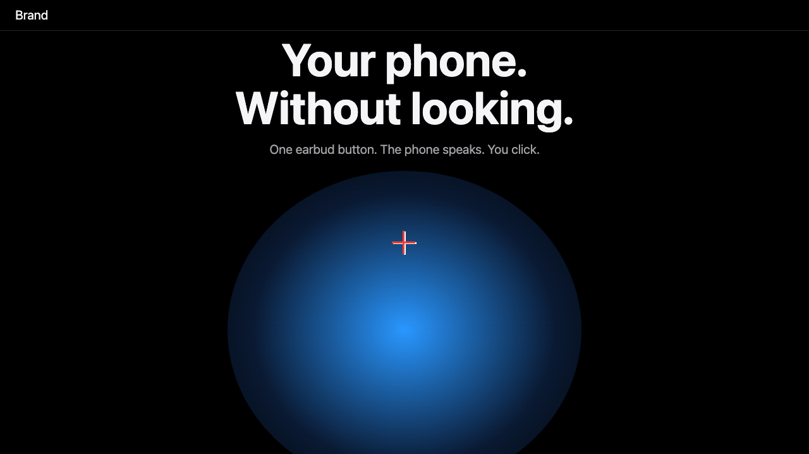
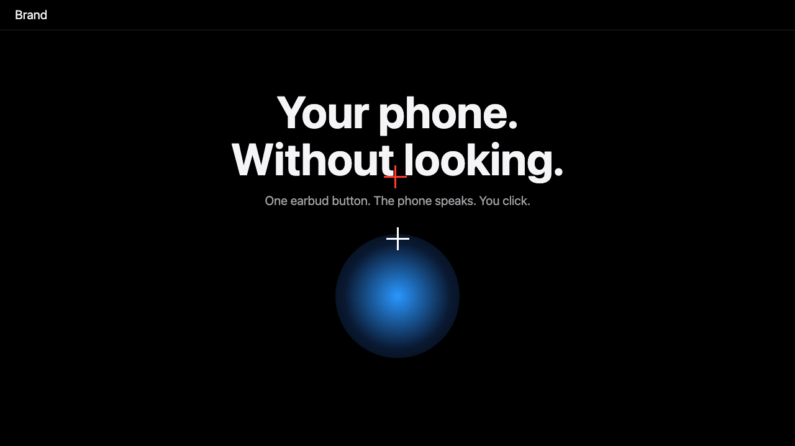

<div align="center">

# layout-balance

**Measure the visual balance of any web page. Fail the build when it looks off.**<br>
Deterministic. No AI. No screenshots to approve by hand.

[Website](https://layout-balance.vercel.app) · [Quick start](#quick-start) · [What it checks](#what-it-checks) · [Use it in CI](#use-it-in-ci) · [Configure](#configure) · [Use it with an AI coding agent](#use-it-with-an-ai-coding-agent)

</div>

<br>

`layout-balance` is a command line tool and Node library that opens a page in a real browser (Playwright), looks at each screen at several window sizes, and checks numbers: where the visual weight sits, how much empty space is above and below, whether one picture is too big, whether text touches an edge or is cut by the fold. If a rule fails, it prints a plain message and exits with code 1, so your CI stops.

It is a design linter for layout: the same idea as ESLint, but for "does this screen feel balanced".

| Fails: top-heavy, huge picture, cut by the fold | Passes: even space, picture in proportion |
|---|---|
|  |  |

White cross = the middle of the screen. Red cross = the centre of visual weight. `layout-balance --out report` writes these images so you can see the problem.

## Quick start

```sh
npx github:IFAKA/layout-balance http://localhost:3000
```

```text
FAIL 1280x720  page
       - fold-cut: content runs past the bottom of the screen (limit 0)
       - top-clearance: content starts 2px under the top bar (limit 0.04)
       - dominance: one picture takes 75% of the screen (limit 0.45)

1 of 1 screens fail
```

Needs Node 20 or newer and Chrome (it falls back to Playwright's Chromium: run `npx playwright install chromium` once).

## How it works

Think of the screen as a see-saw. Every block is a child sitting on it. A big bright block is heavy. A small dim one is light. The tool checks that the see-saw does not tip.

1. It loads your page at each window size (phone, small laptop, laptop, desktop).
2. It scrolls to each `<section>` (or checks the whole page) and waits for animations to settle.
3. It reads the position of every text, image, canvas and shape from the page, and takes one screenshot.
4. **Weight** comes from the screenshot: each pixel counts by how far its brightness is from the background. The centre of all that weight is compared with the middle of the screen.
5. **Space** comes from the page's own boxes: gaps, margins, and what is cut by the edges.
6. Each number is compared with a limit. Same page, same result, every run.

Screens that are taller than the window (long scrolling sections) are only checked for sideways scroll, edge cuts and tight gaps. Screens that are meant to fit one window (a hero, a pinned scene) get the full balance checks.

## What it checks

| Rule | Plain meaning | Default limit |
|---|---|---|
| `centre-x` | Visual weight is too far left or right | 10% of the width |
| `centre-y` | Visual weight is too high or too low | 20% of the height |
| `whitespace-tilt` | Empty space above the content and below it is very uneven | 12% of the height |
| `top-clearance` / `bottom-clearance` | Content is too close to the top bar or the bottom edge | 4% of the height |
| `dominance` | One picture or shape is taller than a share of the screen | 45% |
| `fold-cut` | Text, or content that should fit, is cut by the bottom of the screen | 0 px |
| `edge-cut` / `edge-touch` | Something runs past the side edge, or text is under 12 px from it | 0 / 12 px |
| `overflow-x` | The page scrolls sideways | never |
| `min-gap` | Two stacked blocks are less than 8 px apart | 8 px |

These rules catch the common reasons a page "feels off". They cannot judge taste. A page can pass and still be ugly. The goal is a floor: no page ships top-heavy, crowded or cut off.

## Get a tested fix, not just the failure

```sh
npx github:IFAKA/layout-balance http://localhost:3000 --fix --write ./public
```

The tool tries changes on the real page, measures again, and repeats in a fixed order until every screen passes at every viewport. It then finds, through Chrome, the CSS rule that already sets each value and prints the edit to that rule: `style.css:37  .hero: height: 560px -> 42.7svh`. No patch, no `!important` (it keeps one only where your rule already has it). A last run of the finished edits on a clean copy must pass before it prints `TESTED FIX`. With `--write DIR` it makes the edits in your `.css` files and in `<style>` and `style=""` in your `.html`. Edits in generated CSS (bundlers, CSS-in-JS) are printed for you to make in the source. If it cannot reach a pass it says `NOT FULLY FIXED` and lists the screens and rules left. The same page always gives the same edits. `--json` includes `fix`. `--plan` explains the steps in px.

## Use it in CI

GitHub Actions, with your site built and served:

```yaml
- run: npm run build && npx next start -p 3000 &
- run: npx wait-on http://localhost:3000
- run: npx github:IFAKA/layout-balance http://localhost:3000 --out balance-report
- uses: actions/upload-artifact@v4
  if: failure()
  with: { name: balance-report, path: balance-report }
```

The exit code is 0 when every screen passes and 1 when any fails. `--json` prints machine-readable results.

## Configure

Create `balance.config.json` in your project. Anything you leave out uses the default.

```json
{
  "viewports": [{ "name": "phone", "width": 390, "height": 800 }, { "name": "laptop", "width": 1280, "height": 720 }],
  "sections": "main > section",
  "settleMs": 900,
  "rules": { "centerX": 0.08, "dominance": 0.5, "minGap": 12 }
}
```

CLI flags: `--config file`, `--out dir` (writes the red-cross images), `--viewport WxH` (one custom size, for example your own browser window), `--sections css`, `--json`.

## Android phone over adb

```sh
echo '[{ "name": "home", "start": "adb shell am start -n com.example/.MainActivity" }]' > screens.json
npx github:IFAKA/layout-balance android screens.json --out report
```

It reads the screen tree with `uiautomator dump` and the picture with `screencap`, then runs the same rules. The status bar and navigation bar are the "top bar" and are skipped. Pixel limits (`minGap`, `minEdge`) are in dp and scaled to the phone. Use `--serial ID` when several devices are connected. Each screen needs a `start` command (or leave it out to check the screen that is open now).

React Native apps on Android work too: the tool reads the native screen, so a RN `Text` counts as text and a RN `Image` counts as a picture. Tested with a React Native release build on a real phone. iOS is not supported.

## iOS (Simulator, React Native too)

```sh
npx github:IFAKA/layout-balance ios screens.json --out report
# screens.json: [{ "name": "home", "bundle": "com.yourco.app", "start": "xcrun simctl openurl booted yourapp://home" }]
```

It reads the accessibility tree of the app in the iOS Simulator (a small XCUITest runner, built once by `xcodebuild`, no other install; needs Xcode) and the screenshot, then applies the same rules. A React Native `Text` counts as text and an `Image` as a picture. The first run builds the runner (about 20 s); after that the whole run takes a few seconds. Limits: check only, no `--fix` yet; the iOS status bar is not in the tree, so top clearance is measured from the top of the screen, or from a navigation bar if the app has one; real iPhones are not supported yet.

## Use it as a library

```js
import { check, loadConfig } from "layout-balance";
const results = await check("http://localhost:3000", loadConfig());
const failing = results.filter((r) => r.findings.length);
```

## Use it with an AI coding agent

Add one line to your `AGENTS.md` or `CLAUDE.md`: *after any page change, run `npx github:IFAKA/layout-balance <url>` and fix every failure before saying done.* The messages are plain sentences with numbers, so an agent can act on them without looking at the page.

### As a Claude Code skill

```sh
mkdir -p ~/.claude/skills/layout-balance && curl -fsSL https://raw.githubusercontent.com/IFAKA/layout-balance/master/skills/layout-balance/SKILL.md -o ~/.claude/skills/layout-balance/SKILL.md
```

The agent then measures after every UI change, fixes each failure from the numbers, and measures again until the exit code is 0.

## Why it exists

Visual balance is studied (weight maps, moment equilibrium, symmetry scores), and layout checkers exist for overflow and overlap. No tool combined both as a simple gate you can drop into any project. See [research notes](docs/RESEARCH.md).

## Website

https://layout-balance.vercel.app (source in `site/`). It passes its own checks at four window sizes.

## Develop

```sh
npm install
npm test
```

MIT licensed.
